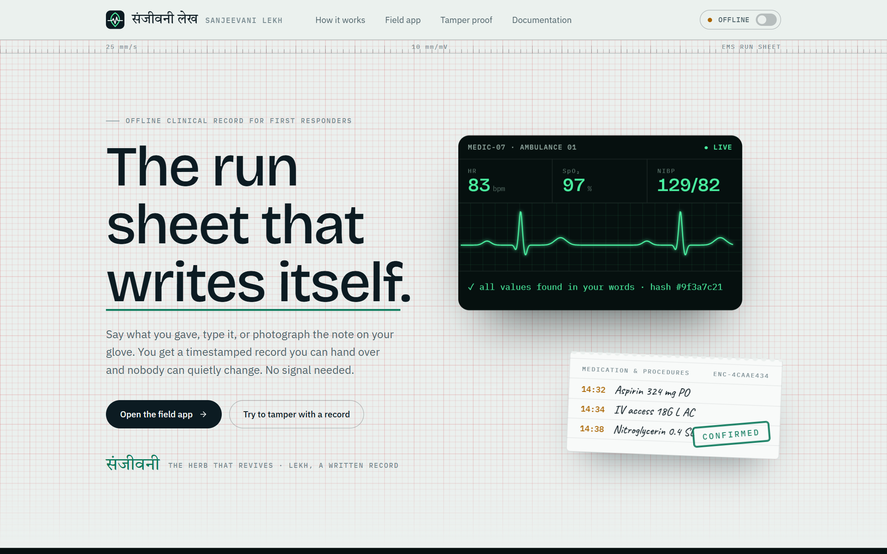
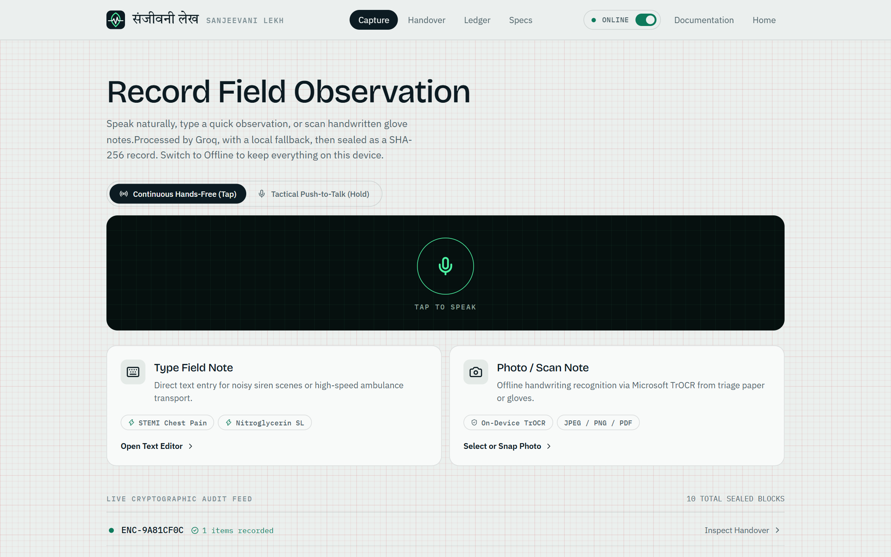
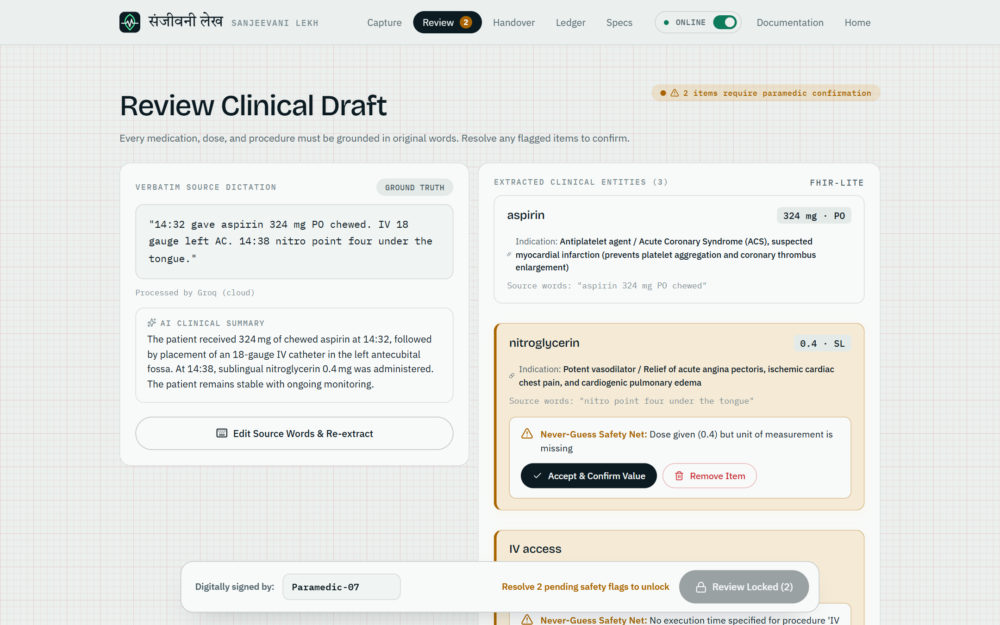
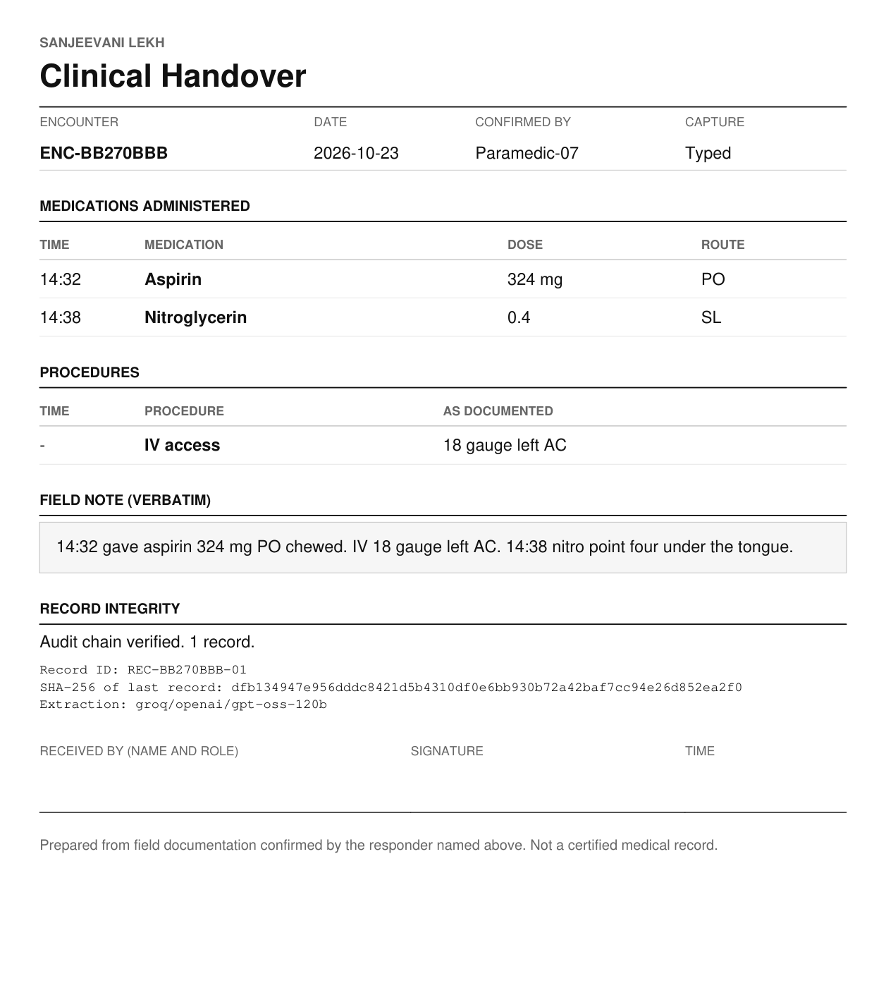
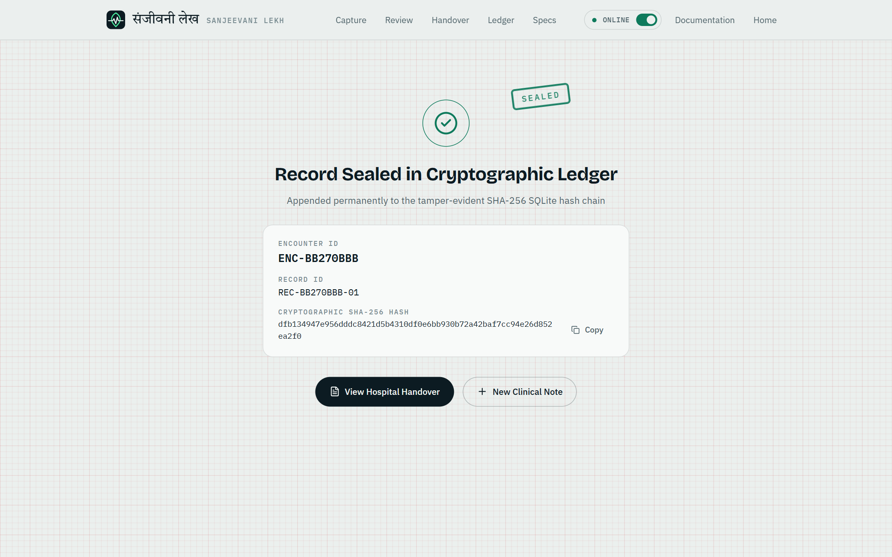
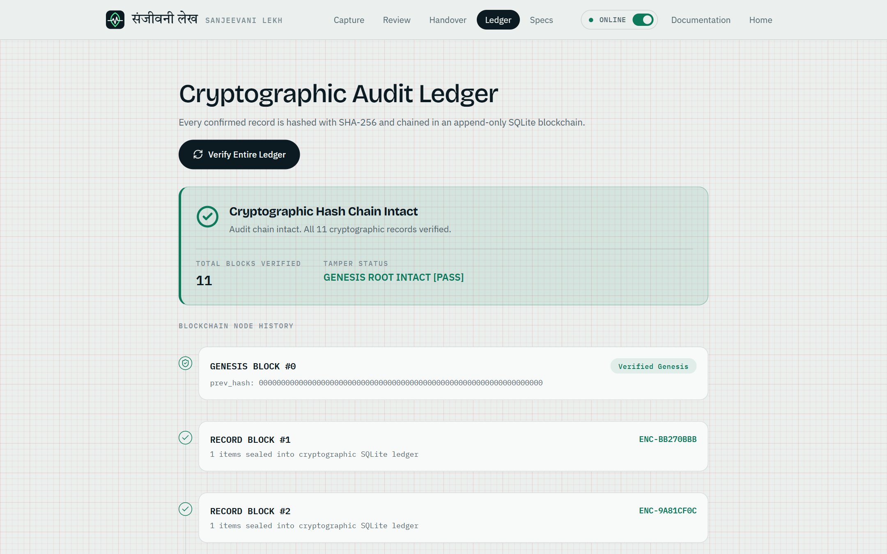
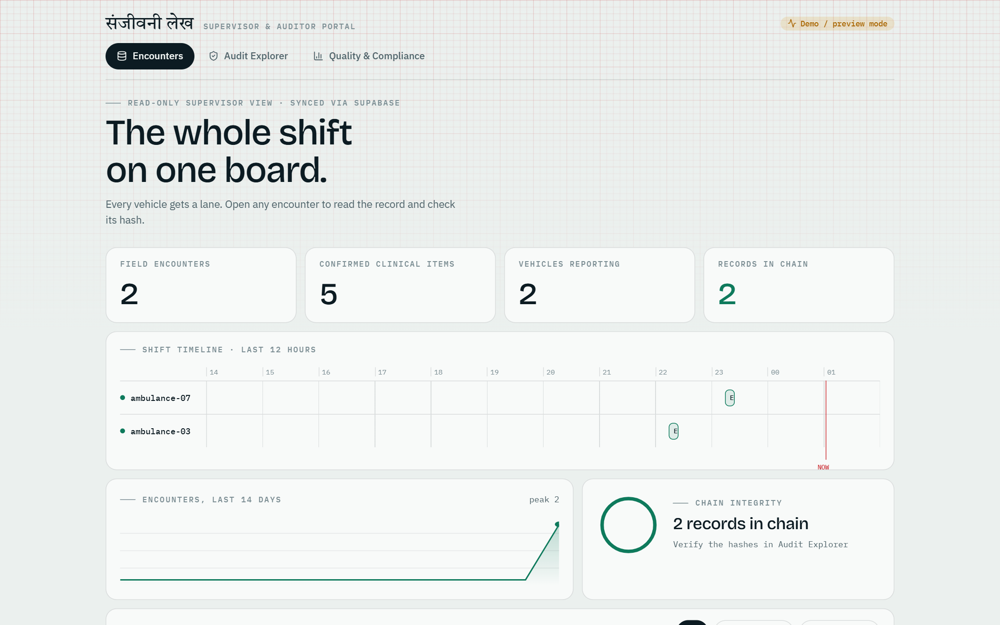

# Sanjeevani Lekh (संजीवनी लेख)

**Field notes in, a sealed clinical record out.**

A first responder speaks, types or photographs a note. Sanjeevani Lekh turns it into a structured, timestamped record of every medication and procedure given, checks each value against the original words, and seals the record in a tamper-evident log. A one-page handover is generated for the receiving hospital.

It works offline on the device. When a connection is available, it can use Groq for faster processing.



---

## Contents

- [The problem](#the-problem)
- [How it works](#how-it-works)
- [Features](#features)
- [Online and offline modes](#online-and-offline-modes)
- [Tech stack](#tech-stack)
- [Quick start](#quick-start)
- [Configuration](#configuration)
- [API](#api)
- [Project structure](#project-structure)
- [Tests and evaluation](#tests-and-evaluation)
- [Screenshots](#screenshots)
- [Data and privacy](#data-and-privacy)
- [Limitations](#limitations)
- [Documentation](#documentation)
- [Contributors](#contributors)

## The problem

During an emergency, drugs and procedures are given faster than they can be written down. Notes end up on gloves, scraps of paper or in memory. The hospital may not know a drug was already given, doses and times are recalled wrongly, and nobody can later prove what happened and when.

## How it works

```
capture ─▶ transcribe / OCR ─▶ extract ─▶ validate ─▶ review ─▶ confirm ─▶ seal ─▶ handover
 voice      Whisper (local     Groq / Ollama   10 rules   human     SHA-256     HTML / PDF
 text       or Groq)           / rule-based    + NER      edits     hash chain  (+ optional sync)
 photo      OCR
```

1. **Capture** by voice, typed text, or a photo of a handwritten note.
2. **Transcribe** audio with Whisper and read images with OCR.
3. **Extract** drug, dose, unit, route, time and procedure into FHIR-lite entries. The extractor is Groq online, a local Ollama model offline, and a built-in rule-based parser as the last fallback.
4. **Validate** every entry against 10 rules. Each value must appear in the source text; anything that does not is flagged, never guessed.
5. **Review** the draft. The responder edits and resolves flags.
6. **Confirm and seal.** Each record is added to a SQLite audit log in which every row stores the SHA-256 hash of the previous one. Database triggers block updates and deletes.
7. **Handover.** A plain clinical handover form is produced as HTML and PDF.
8. **Sync** (optional) pushes sealed records to a Supabase-backed supervisor dashboard.

## Features

- Voice, text and image input
- Online and offline processing with automatic fallback (Groq → Ollama → rule-based)
- "Never guess" extraction: every value is checked against the source text
- Ten validation rules (see [DOCS/Sanjeevani_Lekh_System_Design.pdf](DOCS/Sanjeevani_Lekh_System_Design.pdf))
- Optional clinical NER cross-check to catch treatments the extractor missed
- FHIR-lite output (`MedicationAdministration`, `Procedure`) with a source-text extension
- Human review before anything is sealed
- Tamper-evident audit chain with an integrity check endpoint
- Clinical handover form (HTML and PDF)
- Supervisor dashboard (Next.js) with encounters, shift board and chain integrity

## Online and offline modes

The field app has an ONLINE / OFFLINE switch in its top bar. It sends an `X-Processing-Mode` header with each request.

| | Online | Offline |
|---|---|---|
| Extraction and summary | Groq chat model | Local Ollama model, then rule-based parser |
| Audio | Groq hosted Whisper | Local Whisper |
| Photos | Local OCR | Local OCR |

If an online call fails for any reason, the backend falls back to the local path. The engine that produced each record is stored with it. Without a `GROQ_API_KEY` the backend always runs offline, and `PROCESSING_MODE=offline` makes offline the default.

Online mode sends note text and audio to a third-party service. Use only synthetic data with it.

## Tech stack

| Layer | Technology |
|---|---|
| Backend | Python 3.12, FastAPI, SQLite (WAL) |
| Online AI | Groq: `openai/gpt-oss-120b`, `whisper-large-v3-turbo` |
| Offline AI | Ollama (any local model you set), Whisper, rule-based fallback |
| OCR | Apple Vision via `ocrmac`, or EasyOCR |
| Clinical NER (optional) | `samrawal/bert-base-uncased_clinical-ner`, `emilyalsentzer/Bio_ClinicalBERT` |
| Handover | Jinja2 template, Chromium-rendered PDF |
| Field app | React 18, Vite, Lenis |
| Dashboard | Next.js 14, Supabase |

## Quick start

Requirements: Python 3.12, Node.js 20+. Optional: Ollama and ffmpeg for fully offline use.

**One command** (Git Bash, macOS or Linux):

```bash
./start.sh
```

It creates the Python venv, installs dependencies, copies `.env.example` to `backend/.env` if missing, and starts everything:

| Service | URL |
|---|---|
| Field app | http://localhost:5173 |
| Dashboard | http://localhost:3000 |
| API docs | http://localhost:8000/api/docs |

Ctrl+C stops all three.

**Manually:**

```bash
# backend
cd backend
python3.12 -m venv .venv
source .venv/bin/activate          # Windows: .venv\Scripts\activate
pip install -r requirements.txt
uvicorn app.main:app --port 8000

# field app (new terminal)
cd local-ui && npm install && npm run dev

# dashboard (new terminal)
cd dashboard && npm install && npm run dev
```

For offline AI, install [Ollama](https://ollama.com), pull a model, and set `OLLAMA_BASE_URL` and `LLM_MODEL` in `backend/.env`. Optional clinical NER models are cached with `python scripts/download_models.py`.

## Configuration

Copy `backend/.env.example` to `backend/.env`. The `.env` file is git-ignored; never commit it.

| Variable | Purpose |
|---|---|
| `PROCESSING_MODE` | `auto` (default) or `offline` |
| `GROQ_API_KEY` | Enables online mode |
| `GROQ_LLM_MODEL`, `GROQ_WHISPER_MODEL` | Groq model names |
| `OLLAMA_BASE_URL`, `LLM_MODEL` | Local model for offline mode |
| `LLM_TEMPERATURE`, `LLM_NUM_CTX`, `LLM_KEEP_ALIVE`, `LLM_SEED` | Local model tuning |
| `HOST`, `PORT` | Server address |
| `SUPABASE_URL`, `SUPABASE_KEY` | Optional dashboard sync |

## API

Interactive docs are at `/api/docs`.

| Method | Path | Purpose |
|---|---|---|
| GET | `/health` | Service and mode status |
| POST | `/draft/text` | Draft from typed text |
| POST | `/draft/voice` | Draft from audio |
| POST | `/draft/image` | Draft from a photo |
| POST | `/draft/reextract` | Re-run extraction on edited text |
| POST | `/confirm` | Seal a reviewed draft into the audit chain |
| POST | `/correct/{record_id}` | Add a correction as a new chained record |
| GET | `/audit/verify` | Recompute and verify the hash chain |
| GET | `/encounters`, `/encounters/{id}` | List and read encounters |
| GET | `/encounters/{id}/report` | Handover as HTML |
| GET | `/encounters/{id}/report.pdf` | Handover as PDF |
| POST | `/sync` | Push sealed records to Supabase |
| POST | `/clinical-ner/entities` | Optional clinical entity extraction |
| POST | `/clinical-ner/embedding` | Optional clinical embeddings |

## Project structure

```
backend/        FastAPI service
  app/          main, cloud (Groq), extract, rule_extractor, validate, fhir,
                db (audit chain), report, ocr, transcribe, clinical_ner, sync
  prompts/      extraction prompts
  scripts/      evaluate.py, tamper_demo.py, download_models.py
  templates/    handover template
  tests/
local-ui/       React + Vite field app and landing page
dashboard/      Next.js supervisor dashboard
test-data/      synthetic notes and answer keys
DOCS/           design documents, deck, system design PDF, screenshots, diagrams
start.sh        starts API, field app and dashboard together
```

## Tests and evaluation

```bash
cd backend
pytest                      # unit and API tests (cloud calls are mocked)
python scripts/evaluate.py  # extraction accuracy against test-data answer keys
python scripts/tamper_demo.py
```

Some tests need optional model downloads and are skipped or fail without them.

Measured on the 20 synthetic notes in `test-data/`:

| Engine | Medications found (of 27) | Procedures found (of 15) | Dose exact match | Extraction time |
|---|---|---|---|---|
| Built-in rules | 24 | 10 | 78% | about 0.1 s |
| Groq `gpt-oss-120b` | 27 | 13 | 96% | about 1.4 s |

The local Ollama model and Whisper accuracy have not been measured. Twenty synthetic notes is a small sample.

## Screenshots

| Field app | Review | Handover |
|---|---|---|
|  |  |  |

| Sealed record | Ledger | Dashboard |
|---|---|---|
|  |  |  |

## Data and privacy

- No real patient data is used anywhere. Test notes in `test-data/` are synthetic.
- Do not send real patient data through online mode.
- Datasets with restrictive licences (n2c2, MIMIC) are not committed to this repository.
- `backend/.env` holds secrets and is git-ignored.

## Limitations

- Research and portfolio project. **Not a medical device.** Every record must be reviewed and confirmed by a qualified responder.
- Offline accuracy depends on the local model you configure; it has not been benchmarked here.
- Sync, authentication and multi-user access control are minimal.
- The PDF handover and photo OCR depend on optional local tools being installed.

## Documentation

- [System design PDF](DOCS/Sanjeevani_Lekh_System_Design.pdf): architecture, flows, data model, API, tests
- [Project deck](DOCS/Sanjeevani_Lekh_Project_Deck.pptx): 27-slide walkthrough
- [ARCHITECTURE.md](DOCS/ARCHITECTURE.md), [DESIGN.md](DOCS/DESIGN.md), [REQUIREMENTS.md](DOCS/REQUIREMENTS.md), [PROMPTS.md](DOCS/PROMPTS.md)
- [MODELS.md](DOCS/MODELS.md), [whisper.md](DOCS/whisper.md)
- [Diagrams](DOCS/diagrams/) and [screenshots](DOCS/screenshots/)

## Contributors

- **Milind Verma** · [GitHub](https://github.com/Milindverma24)
- **Nikhil Agrawal** · [GitHub](https://github.com/agnikhil9897)
- **Gaurav Kumar** · [GitHub](https://github.com/gk16122004)
- **Riya Mehta** · [GitHub](https://github.com/1754riya)
